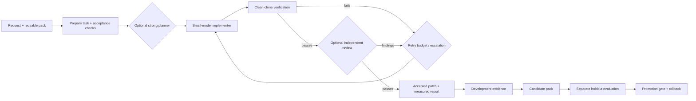

# SuperCodex

**Stronger workflows. Smaller models when they work. Measured cost.**

SuperCodex wraps the Codex CLI in a local engineering and evaluation harness. Give it a task, a repository, and executable acceptance checks. It produces a verified patch, a complete run record, and evidence for improving your next run.

Run **`sc`** or **`supercodex`** to open native Codex with SuperCodex's operator skill, twelve task skills and any selected task pack. A session-local prompt hook tells Codex to run each submitted request through `super-codex answer` and inspect its receipt. The hook saves the exact prompt in a private file, preserving quotes and multiline text. The native terminal layout, authentication and permission controls remain in place.

Skill discovery remains part of the workflow: select relevant guidance, read it, then apply it during the task. Use **`sc --no-prompt-hook`** for skills-only work with native tools, or **`sc --managed`** for the controller's own interface. The default hook injects routing instructions; a completed command and receipt establish that execution actually happened. The outer Codex interface streams normally, while the delegated `answer` command currently uses buffered exec output.

This describes the **unreleased 0.5.5 development build**. The release links below still install 0.5.0, whose default is the managed controller. Install this checkout with `pipx install --force .` to test 0.5.5, then restart `sc`. Skill instructions guide the model; they do not guarantee accuracy or replace execution evidence.

Independent community project. Not affiliated with or endorsed by OpenAI. “Super” describes the goal; improved accuracy and lower cost must be demonstrated on your tasks.

## What you get

- **Four strategies:** economy, selective escalation, strong planner + small implementer, and independent review for accuracy.
- **Skills in native Codex:** `sc` provides skill discovery, research, GitHub/Atlassian context, browser work, planning, debugging, verification and economical delegation, plus evaluation and learning workflows. The operator selects a small relevant set and reads skill files on demand.
- **Enforced execution when selected:** `sc --managed` owns preparation, verification and receipts. Its live transport displays public response text and tool activity; `--managed --no-stream` selects buffered exec for compatibility.
- **Disposable Git clones:** workers edit isolated copies; candidates are checked in another clean clone before any accepted patch is applied.
- **Evidence-driven repairs:** bounded retries with failing checks, compact handoffs, and stall detection.
- **Discoverable task packs:** list, inspect, suggest and create dedicated harnesses with selected instructions, skills, checks, MCP tools and model policy.
- **Measured improvement:** one-command instruction experiments, fresh holdouts, complete tuning accounting, gated local releases and rollback.
- **MCP presets:** Playwright, GitHub, Atlassian, OpenAI documentation, and a generic custom server example.
- **Local reports:** attempts, checks, patches, model usage, cached tokens, estimated cost, latency, and failure classifications.
- **Opt-in experiments:** parallel candidates and specialists, learned routing, verified experience retrieval, ACE playbooks, upstream GEPA, recursive calls and local LoRA training.
- **No core runtime Python dependencies.** GEPA and fine-tuning have optional extras. Python 3.11+, Git, and Codex. macOS/Linux; Windows via WSL is unverified.

Explicit managed runs and pack improvement follow this workflow:



## Start in two minutes

Install a published version without cloning (requires Python 3.11+, Git, Codex and pipx). Versioned packages are distributed through [GitHub Releases](https://github.com/AryamanCoupa/super-codex/releases):

```bash
pipx install "https://github.com/AryamanCoupa/super-codex/releases/download/v0.5.0/super_codex_harness-0.5.0-py3-none-any.whl"
pipx ensurepath

# Reopen your terminal after updating PATH.
cd /path/to/your-project
sc
# Or start with a task:
supercodex "Fix the pagination bug and verify the edge cases"
```

The [setup guide](docs/INSTALLATION.md) covers prerequisites, release and source-archive installation, local development builds, upgrades and troubleshooting. The [maintainer guide](docs/RELEASING.md) explains publishing new versions. The package is not published to PyPI. The following mode selectors describe 0.5.5; install the local checkout to try them.

```bash
sc --repo /path/to/project --config architect
# Direct managed requests:
sc answer "Research this question"
sc answer --prompt-file /path/to/message.txt --context-file /path/to/context.txt
sc --pack frontend --mcp playwright "Fix the checkout interaction"
sc --managed "Fix the pagination bug and verify its contract"
sc --managed --task /path/to/task.json --patch-only
sc --managed --research-mcp github "Find repositories matching my query"
sc --dry-run                       # preview only, no model call or files
sc --no-prompt-hook                 # skills-only native work, no per-message routing
sc skills                          # bundled skill names, descriptions and paths
sc skills --search "GitHub repositories" # find bundled guidance by task keywords
sc skills github-context           # read one skill without a model call
sc commands                        # all harness commands remain available
sc experimental list
sc --native                        # explicit alias for the default Codex interface
sc --managed --no-stream            # enforced controller, buffered compatibility transport
```

The native operator inherits Codex configuration and receives names, descriptions and absolute paths for bundled skills. `sc skills --search "task keywords"` searches bundled metadata without model calls or third-party installation. Default sessions register only the owned hook with exact session-scoped trust; existing user hooks and global configuration remain unchanged. The hook supplies an `answer --prompt-file` command before each user request, including research and coding. Managed child calls have separately selected tools and budgets; their receipts do not include the outer operator's inference cost. See [routing, skills and evidence](docs/AGENT_USAGE.md#run-with-sc).

For compatibility, `--task`, `--patch-only` and `--no-stream` also select managed mode. They conflict with explicit `--native`. Research flags can configure delegated requests in the default hooked session or be passed directly to `answer` and `--managed`; they cannot be used with `--no-prompt-hook`. Use `sc --managed "TASK"` or `sc answer "TASK"` for noninteractive execution.

From this repository:

```bash
python3.11 -m venv .venv
.venv/bin/python -m pip install -e .
.venv/bin/super-codex doctor
.venv/bin/super-codex demo
```

The default demo is **offline simulation**, makes no model calls, and deliberately fails once before repairing three tiny tasks. It verifies orchestration, not model quality. Every demo needs a new output directory; existing artifacts are never overwritten.

No-install alternative: `python3.11 -m codex_harness demo` from this checkout. After installation, `sc`, `supercodex`, `super-codex` and `ch` are equivalent commands. In 0.5.5, invoking them without a subcommand opens the native Codex interface; a quoted task becomes its initial request. Use `sc --managed "TASK"` for a controller-owned single task, including noninteractive execution. Examples below assume the virtual environment is activated.

For ordinary Codex sessions launched without `sc`, install the operator skill across your projects:

```bash
super-codex agent install --user
super-codex commands
```

Then ask Codex to use `$super-codex` for your task. A project-only installation uses `agent install --repo /path/to/project`. The default `sc` launch loads current packaged guidance without requiring this separate skill installation. Skills and bootstrap instructions guide the native operator; `sc --managed` enforces orchestration. Managed workers automatically receive CLI discovery context. The [agent and cross-directory guide](docs/AGENT_USAGE.md) explains installation, command selection, paths and accounted delegation.

For a live smoke run with your existing Codex authentication:

```bash
codex login
super-codex demo --live --model gpt-6-luna --output .harness/live-demo
```

This invokes a model and consumes account usage. Model IDs are examples verified against official documentation on **2026-11-04**; choose models available to your account. Tested with Codex CLI **0.164.0**. Older CLIs may lack `--ignore-user-config`; upgrade rather than silently changing isolation behavior. [Codex models](https://learn.chatgpt.com/docs/models), [non-interactive mode](https://learn.chatgpt.com/docs/non-interactive-mode).

## Run your own task

SuperCodex can run from any directory against `--repo /absolute/path/to/project`; use absolute task/pack/output paths when working elsewhere. You can invoke `/path/to/super-codex/.venv/bin/super-codex` directly without changing directories or copying the harness.

Create `task.json` outside your target repository, or commit it inside the repository:

```json
{
  "id": "empty-results",
  "prompt": "Fix the results endpoint so an empty result set returns an empty list instead of failing. Preserve existing response fields.",
  "checks": [["{python}", "-m", "unittest", "discover", "-s", "tests", "-v"]],
  "protected_paths": ["tests", "pyproject.toml", "uv.lock"],
  "baseline_must_fail": true
}
```

```bash
super-codex run task.json --repo /path/to/clean-repo \
  --pack backend --config balanced
```

The repository must have a commit and a clean working tree. Only committed files are cloned. Checks and optional `setup` commands are argv arrays; they run in the cloned repository. `{python}` means the invoking interpreter. For third-party dependencies, create a reproducible local environment in `setup` and use its interpreter in checks. Setup executes for the worker and each clean verifier. Review these commands before running someone else's task.

`sc --managed --task /absolute/path/to/task.json --repo /path/to/clean-repo` uses this contract without a model preparation call and applies a successful patch after source checks. Add `--patch-only` to leave the source unchanged. After applying a patch, commit your intended changes before the next coding task; SuperCodex does not commit or discard work automatically. The lower-level `run` command always leaves application to you.

Run the harness from a separate working directory, or use `--output /path/outside/target/runs`. If output is inside the target repository, it must already be covered by a Git ignore rule; the tool checks this before writing so generated artifacts do not dirty your checkout.

`baseline_must_fail` verifies that a bug-repair task actually fails before the agent works. Omit it for feature tasks whose existing tests already pass, and provide acceptance tests that genuinely distinguish a complete implementation. A passing command is only as meaningful as its assertions.

Successful runs write `.harness/runs/<id>/accepted.patch`. Every attempt preserves a candidate patch, even when rejected. Review and apply an accepted patch yourself:

```bash
git -C /path/to/target apply --check /absolute/path/to/accepted.patch
git -C /path/to/target apply /absolute/path/to/accepted.patch
```

## Choose how much intelligence to spend

| Policy | Planner | Implementer | Escalation | Extra review | Useful starting point |
|---|---|---|---|---|---|
| `economy` | None | Luna | None | None | Small, well-tested fixes |
| `balanced` | None | Luna | Sol after two failed attempts | None | General coding work |
| `architect` | Sol | Luna | Sol | None | Hard reasoning, manageable edits |
| `accuracy` | Sol | Luna | Sol after one failure | Sol | Requirements beyond existing tests |

Select a preset with `--config architect`, or pass your own TOML path. Preset files live in `codex_harness/assets/policies/` and are included in the Python package.

These are hypotheses to compare, not a universal ranking. Planning and review run as separate read-only Codex sessions. The planner produces a short task breakdown; a single worker executes it. Review is a structured pass/fail gate after deterministic checks. Reviewer findings go back into the repair loop. All roles share accounting and budgets. Reviewers can still be wrong.

Version 0.3 provides the additional methods under a separate experimental command group:

```bash
super-codex experimental list
super-codex experimental best-of-n task.json --repo /path/to/repo \
  --config economy --candidates 3 --concurrency 2 \
  --max-total-tokens 300000 --output .harness/experiments/samples-01
```

Start with one method that addresses an observed failure. Teams gather evidence in parallel and use one implementer; independent candidates each receive clean verification. The [experiment guide](docs/EXPERIMENTS.md) covers routing, memory, ACE/GEPA, recursive calls and fine-tuning, including dependencies and limits. [Research coverage](docs/RESEARCH_COVERAGE.md) distinguishes implemented algorithms, local adaptations and remaining boundaries. None of these methods has a demonstrated cost or accuracy advantage on representative tasks in this repository yet.

## Make a harness for a recurring task

```bash
super-codex pack list
super-codex pack suggest task.json --repo /path/to/repo
super-codex pack inspect backend
super-codex pack create .harness/packs/my-api --from backend \
  --task task.json --repo /path/to/repo
super-codex run task.json --repo /path/to/repo --pack .harness/packs/my-api
```

`list` also discovers packs under `.harness/packs` and active registries under `.harness/registries`. Use `--root ./other-packs` for another location, or `--json` for structured output. `suggest` explains task/repository matches without a model call; `--from-runs .harness/runs` can flag recurring failures for an experiment. Rankings are heuristics, and you choose the pack explicitly.

Bundled packs: `backend`, `frontend`, and `issue-to-patch`. `create` copies skills and tools but requires real checks from your task; unspecified checks remain incomplete. `pack fork` is still available for an exact editable copy. Edit `instructions.md` for recurring constraints and `pack.toml` for checks, policy and matching hints. A pack includes skills explicitly listed in its manifest; add your own under `skills/<name>/SKILL.md`. Separately, native `sc` exposes the full catalog of twelve bundled skills for on-demand selection. See the [skill coverage table](docs/AGENT_USAGE.md#bundled-skill-coverage).

For controlled self-improvement, use a development run produced by that exact pack and a separate holdout suite:

```bash
super-codex pack optimize .harness/packs/my-api \
  --from-result .harness/runs/DEV_RUN_ID/result.json \
  --holdout holdout.json --repo /path/to/repo \
  --registry .harness/registries/my-api \
  --output .harness/experiments/my-api-01 --cost-metric tokens
super-codex run next-task.json --repo /path/to/repo \
  --pack .harness/registries/my-api
```

This invokes models. It proposes one bounded instruction edit, compares matched baseline/candidate trials, and promotes only if quality and cost gates pass. Defaults require at least three distinct holdout tasks and ten runs per variant; repeated cycles need fresh holdouts. `tokens` is an explicit proxy; configure prices and use the default USD metric for money comparisons. There is no automatically running background optimizer. Optional ACE/GEPA experiments produce candidate packs for separate evaluation; local open-model training is a separate command. See [the complete guide and holdout JSON format](docs/TASK_PACKS.md).

## Connect tools

Use only the servers a task needs:

```bash
super-codex run task.json --repo /path/to/repo --pack frontend --mcp github
super-codex run task.json --repo /path/to/repo --pack issue-to-patch --mcp atlassian
super-codex mcp playwright github atlassian
```

The last command prints a Codex TOML snippet without changing your settings. [MCP setup](docs/INTEGRATIONS.md) covers OAuth, tokens, Playwright installation, custom servers, existing Codex configuration, and network boundaries.

## Measure before calling it better

```bash
super-codex fixtures .harness/bench
# Inspect and customize the generated suite before making paid model calls.
super-codex eval .harness/bench/suite.json --output .harness/evals
super-codex report .harness/evals
super-codex report .harness/evals --json
```

The sample suite schedules **27 independent runs**: 3 toy tasks × 3 variants × 3 repeats. It is a smoke experiment, not a representative benchmark. Add your own development and holdout tasks. [Evaluation guide](docs/EVALUATION.md) explains comparisons and metrics.

## Limits that matter

- **Token and dollar limits are soft between-turn limits.** Codex emits aggregate usage after a turn; a turn can exceed a limit. The wrapper enforces process timeouts and limits output size, then refuses further paid stages after a spent budget. Git preparation also has bounded timeouts and can extend the nominal overall deadline.
- **Cost is an estimate, not an invoice.** Configure current per-model input/cached-input/output rates. Missing prices stay `null`. Subscription credits, cache-write pricing, external tools and local hardware cost may not map to this three-rate estimator.
- **Trusted local code only.** Verifier and setup commands execute on your machine with a restricted environment, not an OS container. Git clones protect your checkout; they are not hostile-code isolation. See [SECURITY.md](SECURITY.md).
- **Checks do not prove correctness.** Protected paths catch ordinary test weakening; they are not an adversarial benchmark security boundary. Add independent acceptance tests and human review for consequential changes.
- **Codex first.** Ollama/LM Studio flags are an experimental extension point. Full open-model compatibility and quality evaluation are later work.

## Evidence and status

The offline suite exercises orchestration, accounting, test integrity, advisor gates, and pack lifecycle. A real Luna smoke run fixed the empty-input fixture in 27.2 seconds and passed its three assertions. It used 79,754 input tokens (63,104 cached) and 573 output tokens. The preceding sandboxed launch failed before model execution and is recorded separately. These observations establish a working integration, **not an accuracy uplift or cost saving**. [Validation record](docs/VALIDATION.md).

MIT licensed. Read [CONTRIBUTING.md](CONTRIBUTING.md), [the research review](docs/RESEARCH.md), and [the architecture](docs/ARCHITECTURE.md).

The [extended Playwright research review](docs/RESEARCH_UPDATE.md) and [current coverage map](docs/RESEARCH_COVERAGE.md) connect the implementation to evolving task knowledge, learned repository skills, stronger verifiers, recursive model calls and weight adaptation.
